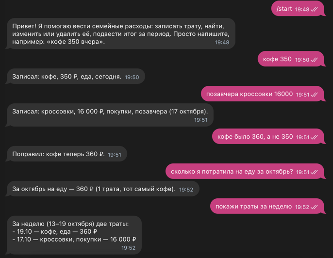
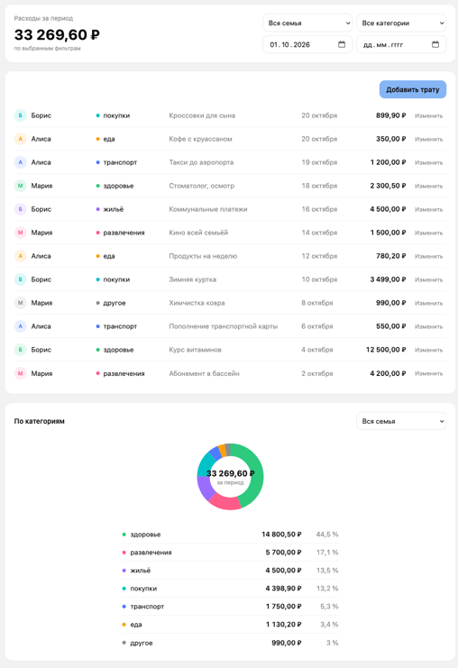

# family-expenses-bot

Сервис учёта семейных расходов. Член семьи пишет боту в Telegram «кофе 350», и трата сохраняется: бот сам определяет сумму, категорию и дату.

Сервис состоит из двух частей:
- **Telegram-бот с ИИ-агентом.** Понимает обычный текст: добавляет, показывает, изменяет и удаляет траты. Каждому члену семьи доступны только его траты.
- **Веб-панель для главы семьи.** Показывает траты всех членов семьи и позволяет их редактировать. Авторизация не нужна.

<p align="center">
  
  &nbsp;
  
</p>

## quick start

```sh
cp .env.example .env
# заполнить LLM_BASE_URL, LLM_API_KEY, LLM_MODEL,TELEGRAM_BOT_TOKEN
docker compose up --build
```

- `TELEGRAM_BOT_TOKEN` можно оставить пустым: сервер стартует в режиме Web-API only.
- Для демонстрации на пустой базе создаётся тестовая семья с тратами за текущий месяц.
- Веб-панель после старта: **http://localhost:3000**.
- Пошаговая проверка всех сценариев: [quickstart.md](specs/001-family-expenses-mvp/quickstart.md).

## dev

```sh
docker compose up -d postgres

make run       
make lint       # golangci-lint 
make test       
          
make generate   # ogen + sqlc
make eval       

cd web && npm run dev   # веб панель
npm run build           # production 
npm run gen:api         
```


## doc

- [Quickstart](specs/001-family-expenses-mvp/quickstart.md) — сквозные сценарии проверки.
- [Контракты](specs/001-family-expenses-mvp/contracts/) — REST, тулы агента, коды ошибок.
- [ADR](docs/decisions.md) — архитектурные решения.
- [Спецификация](specs/001-family-expenses-mvp/spec.md) и [план](specs/001-family-expenses-mvp/plan.md) — требования и технический план.
- Правила для ИИ-агентов: [AGENTS.md](AGENTS.md), [конституция](.specify/memory/constitution.md).
